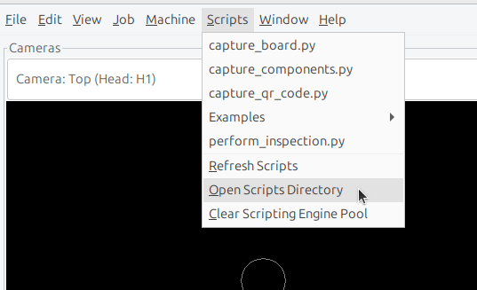

# PnVision - Scripts for Automatic PCB Inspection

Copyright (c) 2026 [Antmicro](https://www.antmicro.com)

This tool is designed to capture images of individual PCB components and complete assembled boards using [OpenPnP](https://openpnp.github.io/) for documentation and reference purposes.

## Installation

### PnVision scripts

> [!IMPORTANT]
> All tagged versions have been tested with OpenPnP 2.6 and 2.7 press-play-walk-away fork.

Requirements:

- Python ≥ 3.10
- libzbar0
- pipx
- [kicad-make](https://github.com/antmicro/kicad-make) (optional; can be used to generate position files)

To install the script, run the following command in the project repository:

```bash
pipx install .
```

You can now use:

```bash
pnvision --help
```

### OpenPnP scripts

In OpenPnP, select `Scripts`, then `Open Scripts Directory`, and copy all files and folders from `openpnp_scripts`.



## Usage

### OpenPnP scripts

From the top toolbar, select `Scripts`, then click `perform_inspection.py` and follow the instructions displayed in the pop-up windows.

### PnVision scripts

Available commands:

| Command | Description |
|---|---|
| `report` | Generate an HTML report from a scan |
| `stitch` | Stitch OpenPnP images into one board image |
| `code` | Read a QR code from an image |
| `bom` | List DNP designators from the BOM |
| `version` | Print the installed version |
| `collage` | Generate a component collage |
| `detect-cv` | Detect component placement |
| `deploy` | Deploy CI-generated data to OpenPnP |

### Examples

```bash
pnvision report [--template-dir TEMPLATE_DIR] INPUT_JSON
```

- `TEMPLATE_DIR` - template directory with `report.html`, `favicon.ico`, and `logo.svg`
- `INPUT_JSON` - input report JSON file

```bash
pnvision code IMAGE_PATH
```

- `IMAGE_PATH` - The image file with QR or barcode

## License

This project is published under the [Apache-2.0](LICENSE) license.

