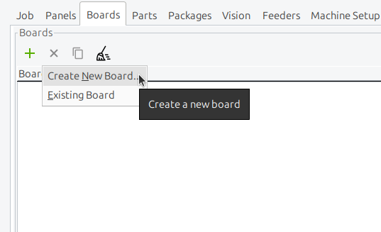
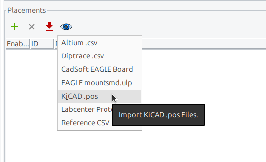

# PnVision - Scripts for automatic PCB inspection

Copyright (c) 2026 [Antmicro](https://www.antmicro.com)

This tool was designed to capture images of individual PCB components and complete assembled boards using [OpenPnP](https://openpnp.github.io/) for documentation and reference purposes.

## Table of Contents

1. [Installation](#installation)
2. [Repository structure](#repository-structure)
3. [Usage](#usage)
4. [License](#license)

## Installation

### PnVision scripts:
> [!IMPORTANT]
> All versions tagged have been tested on OpenPnP 2.6 and 2.7 press-play-walk-away fork.

Requirements:

* Python ≥ 3.10
* libzbar0

Optional:
* [kicad-make](https://github.com/antmicro/kicad-make) - can be used for position files generation

To install script, run following command (we suggest using `pipx`):

```bash
pipx install .
```
in the project repository.

You can now use:

```bash
pnvision --help
```

### OpenPnP scripts:
1. In OpenPnP presss `Scripts` then `Open Scripts Directory` and copy all the files and folders from `openpnp_scripts`.


## Repository structure
* openpnp_scripts/perform_inspection.py - only script visible to the user, it launches secondary scripts

* openpnp_scripts/secondary_scripts - scripts hidden from the user

* openpnp_scripts/Events - scripts that are triggered by OpenPnP during machine operation

* src/pnvision - repository for report generation and scan management

```
.
├── openpnp_scripts
│   ├── Events
│   │   └── Feeder.AfterFeed.py
│   ├── perform_inspection.py
│   └── secondary_scripts
│       ├── capture_board.py
│       ├── capture_components.py
│       ├── ...
│       └── capture_qr_code.py
└── src
    └── pnvision
        └── commands
            ├── __init__.py
            ...
            ├── version.py
            └── helpers
                ├── bash_wrapper.py
                └── __init__.py
```


## Usage
### PnVision scripts:
Available commands:

| Command | Description |
|---|---|
| `report` | Generate an HTML report from a scan |
| `stitch` | Stitch OpenPnP images into one board image |
| `code` | Read a QR code from an image |
| `bom` | List DNP designators from the BOM |
| `version` | Print the installed version |
| `collage` | Generate a component collage |
| `detect-cv` | Detect component placement |
| `deploy` | Deploy CI-generated data to OpenPnP |

### Examples

```bash
pnvision report [--template-dir TEMPLATE_DIR] INPUT_JSON
```
* TEMPLATE_DIR - Template directory with report.html, favicon.ico and logo.svg
* INPUT_JSON - Input report JSON file

```bash
pnvision code IMAGE_PATH
```
* IMAGE_PATH - The image file with QR or barcode

### OpenPnP scripts:
> [!IMPORTANT]
> Components with `Exclude from bill of materials` property set will have `null` assigned in the report.

1. Open your KiCad board in PCB Editor, select `File -> Fabrication Outputs -> Generate Placement Files`, Select `Format` as `Plain Text`.

Alternatively kicad-make tool can be used to generate .pos files:

```bash
kmake loclib
kmake gerber
kmake aux-origin -s bl
kmake pnp -to --dnp
```

> [!IMPORTANT]
> Next steps are be done on OpenPnP, please clean the board before scanning

2. Create new board in `Boards` panel. Make sure the board name is the same as project's name (this name will be saved to report.json)



3. Press the created `Board` and go down to `Import placements from CAD files`



4. In the new pop-up, add your generated .pos files from `1.`. Then select `Assign Parts` and `Create Missing Parts`. Selecting `Use only Value as PartId` will use `Value` field from Kicad without adding `package`


5. Go to Job tab and add existing board


6. Set the board origin by moving the camera to the bottom-left corner of the PCB outline, where the leftmost and bottommost edges intersect. Click the blue square button to set the origin.


7. Optional: set board dimensions in OpenPnP if you want the whole board image to be taken


8. Optional: add placement with `QR*` designator and assign its location to QR code if you want to automatically assign the serial number

9. Optional: set fiducials as type: `Fiducial` and assign them corresponding part

10. Perform a calibration using placements or fiducials (seee point `9.`)


11. In machine setup, set `Settle Time` to about 300 ms. You can also change `brightness` and `contrast` in the Device Settings. Note that the speed set in `Machine Controls` affects speed of scanning.


12. Run perform_inspection.py from `Scripts`


13. If prompted, input custom scan location, comment about board assembly, input serial number in the pop-up window, then set your location and add `*-BOM-ALL-ReferenceNotGrouped.csv`

> [!Note]
> BOM in csv format can be generated using kmake bom: `kmake bom --all -g`

14. After the scan is finished, the images are saved to configured custom location. If no custom location is set, they are saved to `$XDG_DATA_HOME/pnvision` if set, otherwise in `~/.local/share/pnvision`

15. It is recommended to scan one side of every board first.

## License
This project is published under the [Apache-2.0](LICENSE) license.
