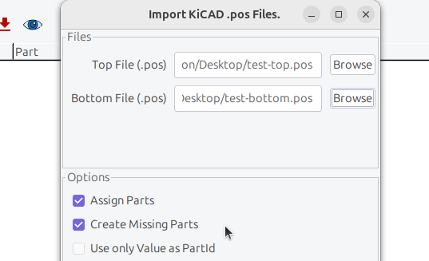
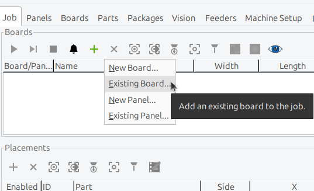
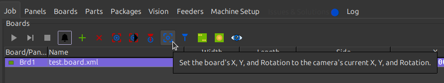
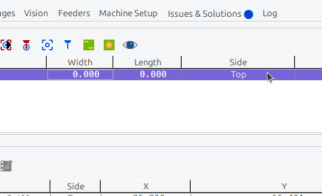
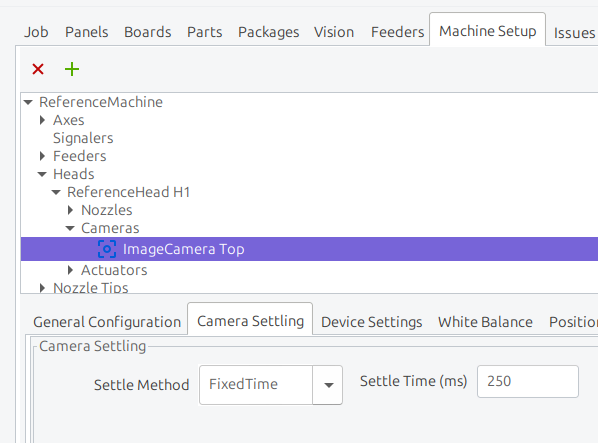
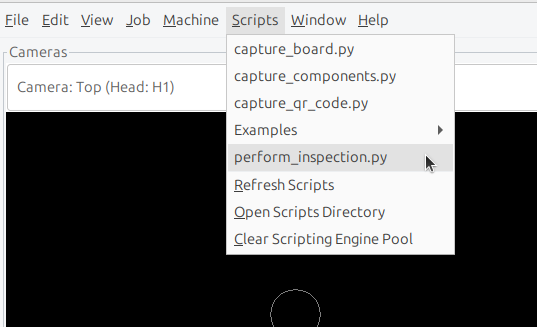

# antmicro-pcb-visual-inspection-framework - Scripts for automatic PCB inspection

Copyright (c) 2026 [Antmicro](https://www.antmicro.com)

This tool was designed to capture images of individual PCB components and complete assembled boards using LumenPnP for documentation and reference purposes.

## Table of Contents

1. [Installation](#installation)
2. [Usage](#usage)
3. [Examples](#examples)
4. [Licensing](#licensing)

---

## Installation

### PnVision scripts:
Version v0.1.1 has been confirmed to work on OpenPnP version 2.5.
Use version v0.1.2+ if you are working with openPnP 2.6+.
Requirements:

* Python ≥ 3.10
* libzbar0

Install pipx if needed:

```bash
python3 -m pip install --user pipx
python3 -m pipx ensurepath
```

Restart your shell after running ensurepath.

To install script run:

```bash
pipx install .
```
in the project repository. This installs the application in an isolated environment and exposes the CLI globally.

Verify installation:

```bash
pnvision --help
```

### OpenPnP scripts:
1. In OpenPnP open scripts directory and add scripts from `openpnp-scripts/`.


## Usage
### PnVision scripts:
To show available functionalities run:

```bash
pnvision --help
```

### OpenPnP scripts:
> **Note**
>
>    Components that have `Exclude from bill of materials` set will have `NA` assigned in the report.

1. Go to your board directory and use the commands below from kmake:
```bash
kmake loclib
kmake gerber
kmake aux-origin -s bl
kmake pnp -tvo --dnp
```

> **Note**
>
>    Next steps are be done on OpenPnp
2. Create new board in `Boards` panel


3. Press the created `Board` and go down to `Import placements from CAD files`


4. In the new pop-up add your generated .pos files from `1.`. Then select `Assign Parts` and `Create Missing Parts`


5. Go to Job tab and add existing board


6. Set the board origin by moving the camera to the bottom-left corner defined by the intersection of the leftmost and bottommost extents of the PCB outline by pressing the blue square button.


7. Optional: set board dimensions in OpenPnP if you want the whole board image to be taken


8. Optional: add placement with `QR*` designator and assign its location if you want to automatically assign the serial number

9. Optional: set fiducials as type: `Fiducial`

10. Perform a calibration using placements or fiducials (check `9.`)


10. In machine setup set `Settle Time` to about 300 ms. In the Device Settings you can also change `brightness` and `contrast`


11. Run perform_inspection.py from `Scripts`


12. If propmpted in the pop-up window input 12 character serial number, e.g: `000.000.0001` and set your location

13. After the scan is finished the images will be available in
`~/.openpnp2/vision/log`

## Examples

```bash
pnvision report [--template-dir TEMPLATE_DIR] INPUT_JSON
```
* TEMPLATE_DIR - Template directory with report.html, favicon.ico and logo.svg
* INPUT_JSON - Input report JSON file

```bash
pnvision stitch [-o OUTPUT] INPUT_FOLDER
```
* OUTPUT - Output file generated by capture_board, defaults to PNG format
* INPUT_FOLDER - Input folder generated by capture_board

