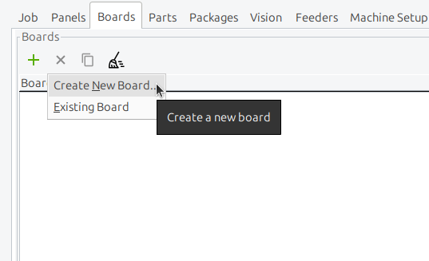
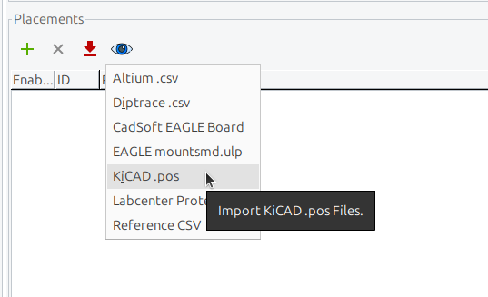
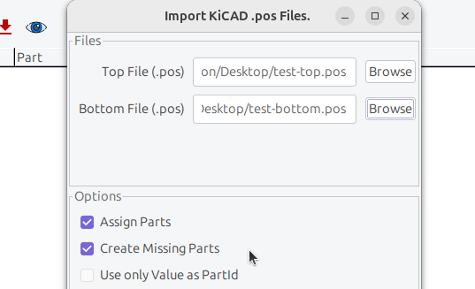
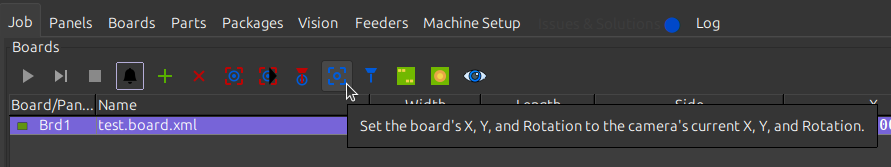
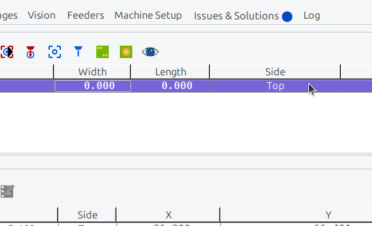
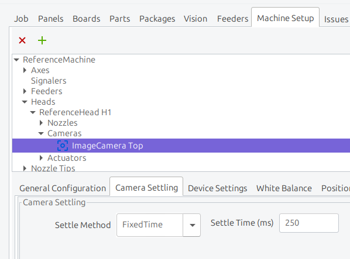
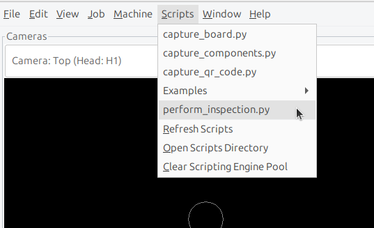

## Options do deploy inspection job onto OpenPnP

### 1. Add board using xmake:
    1. Generate job using xmake
    2. Open OpenPnP and add select the `.job.xml` file
    3. Enable board with `-inspection` suffix, disable all other boards

### 2. Add board manually:
> [!IMPORTANT]
> Components with `Exclude from bill of materials` property set will have `null` assigned in the report.

1. Open your KiCad board in PCB Editor, select `File -> Fabrication Outputs -> Generate Placement Files`, Select `Format` as `Plain Text`.

Alternatively kicad-make tool can be used to generate .pos files:

```bash
kmake loclib
kmake gerber
kmake aux-origin -s bl
kmake pnp -to --dnp
```

> [!IMPORTANT]
> Next steps are be done on OpenPnP, please clean the board before scanning

2. Create new board in `Boards` panel. Make sure the board name is the same as project's name (this name will be saved to report.json)



3. Press the created `Board` and go down to `Import placements from CAD files`



4. In the new pop-up, add your generated .pos files from `1.`. Then select `Assign Parts` and `Create Missing Parts`. Selecting `Use only Value as PartId` will use `Value` field from Kicad without adding `package`



5. Go to Job tab and add existing board


6. Set the board origin by moving the camera to the bottom-left corner of the PCB outline, where the leftmost and bottommost edges intersect. Click the blue square button to set the origin.



7. Optional: set board dimensions in OpenPnP if you want the whole board image to be taken



8. Optional: add placement with `QR*` designator and assign its location to QR code if you want to automatically assign the serial number

9. Optional: set fiducials as type: `Fiducial` and assign them corresponding part

10. Perform a calibration using placements or fiducials (seee point `9.`)


11. In machine setup, set `Settle Time` to about 300 ms. You can also change `brightness` and `contrast` in the Device Settings. Note that the speed set in `Machine Controls` affects speed of scanning.



12. Run perform_inspection.py from `Scripts`



13. If prompted, input custom scan location, comment about board assembly, input serial number in the pop-up window, then set your location and add `*-BOM-ALL-ReferenceNotGrouped.csv`

> [!Note]
> BOM in csv format can be generated using kmake bom: `kmake bom --all -g`

14. After the scan is finished, the images are saved to configured custom location. If no custom location is set, they are saved to `$XDG_DATA_HOME/pnvision` if set, otherwise in `~/.local/share/pnvision`

15. It is recommended to scan one side of every board first.
