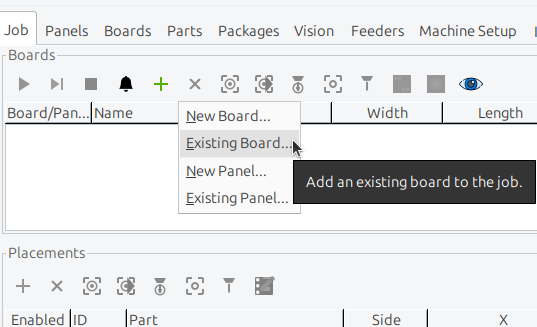
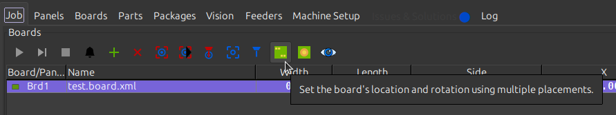

# Adding a new board

## Options do deploy an inspection job onto OpenPnP

### 1. Automated CI-based workflow

```{note}
If you use an automated CI-based workflow, please use the steps below, otherwise proceed with: [2.Add a board manually](#add-a-board-manually).
```

1. Open the .job.xml file in OpenPnP
2. Enable the board with the -inspection suffix
3. Disable all other boards

### 2. Add a board manually

```{important}
Components with the `Exclude from bill of materials` property set will have `null` assigned in the report.
```

1. Open your KiCad board in PCB Editor, select `File -> Fabrication Outputs -> Generate Placement Files`, and `Format` as `Plain Text`.

Alternatively, the [kicad-make](https://github.com/antmicro/kicad-make) tool can be used to generate .pos files:

```bash
kmake loclib
kmake gerber
kmake aux-origin -s bl
kmake pnp -to --dnp
```

```{important}
Next steps will be performed in OpenPnP, please clean the board before scanning.
```

2. Create a new board in the `Boards` panel. Make sure the board's name is the same as the project's name (this name will be saved to report.json).


3. Press the created `Board` and go down to `Import placements from CAD files`


4. In the new pop-up, add your generated .pos files from step `1.`. Then select `Assign Parts` and `Create Missing Parts`. Selecting `Use only Value as PartId` will cause the `Value` field from KiCad to be used, without adding a `package`.


5. Go to `Job` tab and add an existing board.



6. Set the board origin by moving the camera to the bottom-left corner of the PCB outline, where the leftmost and bottommost edges intersect. Click the blue square button to set the origin.


7. Optional: set board dimensions in OpenPnP if you want an image of the whole board to be taken.


8. Optional: add a placement with a `QR*` designator and assign its location to a QR code if you want to automatically assign a serial number.

9. Optional: set fiducials as type: `Fiducial` and assign them corresponding parts.

10. Perform a calibration using placements or fiducials (see step `9.`)



11. In machine setup, set `Settle Time` to about 300 ms. You can also change `brightness` and `contrast` in the Device Settings. Note that the speed set in `Machine Controls` affects the speed of scanning.


12. Run `perform_inspection.py` from `Scripts`


13. If prompted, input a custom scan location, comment about board assembly, input a serial number in the pop-up window, then set your location and add `*-BOM-ALL-ReferenceNotGrouped.csv`

```{note}
BOMs in csv format can be generated using kmake bom: `kmake bom --all -g`
```

14. After the scan is finished, the images are saved to the configured custom location. If no custom location is set, they are saved to `$XDG_DATA_HOME/pnvision` or `~/.local/share/pnvision`.

15. It is recommended to scan one side of every board first.
