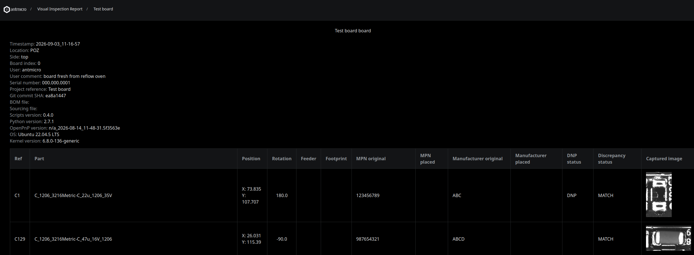
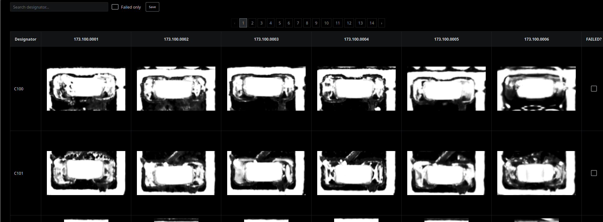

# pnvision usage

`PnVision` is a command-line tool for processing OpenPnP inspection data, generating reports, analyzing component placement, and deploying generated artifacts.

## Usage

```text
pnvision [OPTIONS] COMMAND [ARGS]...
```

## Global Options

| Option | Description |
|---|---|
| `--install-completion` | Install completion for the current shell. |
| `--show-completion` | Show completion for the current shell, to copy it or customize the installation. |
| `--help` | Show this help message and exit. |

## Commands

| Command | Description |
|---|---|
| `report` | Generate an HTML report from a scan. |
| `stitch` | Stitch OpenPnP images into a single board image. |
| `code` | Read a QR code from an image file and print the decoded contents. |
| `bom` | Read `*-BOM-ALL-ReferenceNotGrouped` and return a list of DNP designators. |
| `version` | Print the installed `PnVision` version. |
| `collage` | Generate a collage of components sorted by designator. |
| `detect-cv` | Detect if components are placed using traditional methods. |
| `deploy` | Deploy CI-generated data to an OpenPnP machine. |

---

## `report`

Generate an HTML report from a scan.

### Usage

```bash
pnvision report [OPTIONS] <log_file_location>
```

### Arguments

| Argument | Type | Description |
|---|---|---|
| `log_file_location` | path | Location of `report.json`. **Required.** |

### Options

| Option | Type | Description |
|---|---|---|
| `--template-dir` | path | Override the built-in template directory. |
| `--help` | — | Show help and exit. |

### Example

```bash
pnvision report ./report.json
```

### Result



---

## `stitch`

Stitch OpenPnP images into a single board image.

### Usage

```bash
pnvision stitch [OPTIONS] <image_directory>
```

### Arguments

| Argument | Type | Description |
|---|---|---|
| `image_directory` | path | Directory containing PNG images. **Required.** |

### Options

| Option | Short | Type | Description |
|---|---|---|---|
| `--output` | `-o` | path | Output image filename. |
| `--pixels-per-unit-x` | `-ppx` | float | Pixels per unit in X. |
| `--pixels-per-unit-y` | `-ppy` | float | Pixels per unit in Y. |
| `--delete-tiles` | `-d` | flag | Delete board tiles after stitching is finished. |
| `--help` | — | — | Show help and exit. |

### Example

```bash
pnvision stitch ./images -o board.png
```

---

## `code`

Read a QR code from an image file and print the decoded contents.

### Usage

```bash
pnvision code [OPTIONS] <image_path>
```

### Arguments

| Argument | Type | Description |
|---|---|---|
| `image_path` | path | Path to the image containing the QR code. **Required.** |

### Options

| Option | Description |
|---|---|
| `--help` | Show help and exit. |

### Example

```bash
pnvision code ./qr-code.png
```

---

## `bom`

Read `*-BOM-ALL-ReferenceNotGrouped` and return a list of DNP designators.

### Usage

```bash
pnvision bom [OPTIONS] <bom_path>
```

### Arguments

| Argument | Type | Description |
|---|---|---|
| `bom_path` | path | Path to the BOM. **Required.** |

### Options

| Option | Description |
|---|---|
| `--help` | Show help and exit. |

### Example

```bash
pnvision bom ./*-BOM-ALL-ReferenceNotGrouped.csv
```

---

## `version`

Print the installed `PnVision` version.

### Usage

```bash
pnvision version [OPTIONS]
```

### Options

| Option | Description |
|---|---|
| `--help` | Show help and exit. |

### Example

```bash
pnvision version
```

---

## `collage`

Generate a collage of components sorted by designator.

### Usage

```bash
pnvision collage [OPTIONS] <scans_directory>
```

### Arguments

| Argument | Type | Description |
|---|---|---|
| `scans_directory` | path | Directory containing all scans. **Required.** |

### Options

| Option | Short | Type | Description |
|---|---|---|---|
| `--output` | `-o` | path | Output collage directory. |
| `--help` | — | — | Show help and exit. |

### Example

```bash
pnvision collage ./scans -o collage
```

### Result


---

## `detect-cv`

Detect if components are placed using traditional methods.

### Usage

```bash
pnvision detect-cv [OPTIONS] <report_file> <components_directory>
```

### Arguments

| Argument | Type | Description |
|---|---|---|
| `report_file` | path | Location of `report.json`. **Required.** |
| `components_directory` | path | Directory containing PNG images. **Required.** |

### Options

| Option | Description |
|---|---|
| `--debug` | Save debug images to the `debug` directory. |
| `--help` | Show help and exit. |

### Example

```bash
pnvision detect-cv ./report.json ./components
```

To save debug images:

```bash
pnvision detect-cv ./report.json ./components --debug
```

---

## `deploy`

Deploy CI-generated data to an OpenPnP machine.

### Usage

```bash
pnvision deploy [OPTIONS] <artifacts_directory>
```

### Arguments

| Argument | Type | Description |
|---|---|---|
| `artifacts_directory` | path | Zip directory containing all data. **Required.** |

### Options

| Option | Description |
|---|---|
| `--help` | Show help and exit. |

### Example

```bash
pnvision deploy ./artifacts
```

---

## Getting Help

Show general help:

```bash
pnvision --help
```

Show help for a specific command:

```bash
pnvision <command> --help
```

For example:

```bash
pnvision stitch --help
pnvision detect-cv --help
```